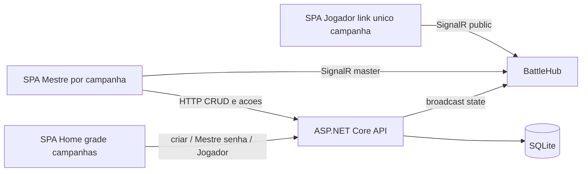

# IniciativasRPG — Backlog mestre

Fonte da verdade do que deve ser feito. Use este arquivo para consultar escopo, prioridades e critérios de aceitação ao planejar cada fase.

**Versão do produto:** v2.0 (planejamento) · **Baseline entregue:** v1.0 (ST-001…ST-020 Done)  
**Stack alvo:** ASP.NET Core Web API + SignalR · React + TypeScript · SQLite (EF Core)  
**Auth (v2.0):** senha de mestre **por campanha** (hash); sem conta global de mestre como modelo principal  
**Sessão (v2.0):** N batalhas por campanha; **1 batalha ativa por campanha**; campanhas distintas podem ter batalhas simultâneas

---

## Índice por prioridade MoSCoW

### v1.0 — entregue (Fases 1–3)

| Prioridade | Stories | Status |
|---|---|---|
| **MUST** | ST-001…ST-006, ST-008, ST-009, ST-011, ST-016…ST-019 | Done |
| **SHOULD** | ST-007, ST-010, ST-012…ST-014 | Done |
| **COULD** | ST-015, ST-020 | Done |

### v2.0 — próximo time-box

| Prioridade | Stories | Justificativa |
|---|---|---|
| **MUST** | ST-021, ST-022, ST-023, ST-024, ST-025, ST-026, ST-031 | Login por campanha é estrutural (BR-004); painel tático resolve dor do mestre (BR-005) |
| **SHOULD** | ST-027, ST-028, ST-029, ST-030 | Enriquecem a ficha; painel tático (MUST) já funciona com dados parciais |
| **COULD** | ST-032, ST-033 | Personalização visual (BR-006); não bloqueia uso funcional |
| **WON'T** | OAuth; conta de usuário/jogador persistente; tema persistido entre sessões | Fora do time-box v2.0 |

---

## Checklist rápido por fase

### Fase 1 — MUST (MVP funcional) — v1.0

- [x] ST-001 Cadastrar ficha
- [x] ST-002 Editar ficha fora de batalha
- [x] ST-003 Invocar player com iniciativa
- [x] ST-004 Invocar criatura (manual ou dado)
- [x] ST-005 Iniciar batalha
- [x] ST-006 Próximo turno (pula mortos / pular turno)
- [x] ST-008 Finalizar batalha
- [x] ST-009 Marcar como morto
- [x] ST-011 Aplicar dano
- [x] ST-016 Card do combatente
- [x] ST-017 Login do mestre
- [x] ST-018 Tela pública via link
- [x] ST-019 Sincronização em tempo real (SignalR)

### Fase 2 — SHOULD — v1.0

- [x] ST-007 Decremento de duração dos modificadores ao fim da volta
- [x] ST-010 Reviver combatente
- [x] ST-012 Restaurar vida (cura)
- [x] ST-013 Cadastrar tipo de modificador
- [x] ST-014 Aplicar/remover modificador em combate

### Fase 3 — COULD (produto completo) — v1.0

- [x] ST-015 Buff/debuff de CA (via modificadores avançados)
- [x] ST-020 Persistência de estatísticas pós-batalha (players)

### Fase 4 — MUST — v2.0 (Campanhas + atributos + painel tático)

- [x] ST-021 Criar campanha (nome, foto, descrição, senha)
- [x] ST-022 Grade de campanhas (tela inicial)
- [x] ST-023 Acesso Mestre com senha da campanha
- [x] ST-024 Acesso Jogador à batalha ativa da campanha
- [x] ST-025 N batalhas por campanha / 1 ativa
- [x] ST-026 Atributos D&D + modificador automático (+ classe estruturada, FR-027)
- [x] ST-031 Painel tático do combatente (somente mestre)

### Fase 5 — SHOULD — v2.0 (Enriquecimento de ficha)

- [x] ST-027 Cadastro de ataques
- [x] ST-028 Cadastro de magias
- [x] ST-029 Cadastro de armas
- [x] ST-030 Resistências (texto livre)

### Fase 6 — COULD — v2.0 (Temas)

- [x] ST-032 Temas por classe (12 + padrão)
- [x] ST-033 Tema só na sessão atual

---

## Objetivos de negócio (RTM)

| ID | Categoria | Descrição | Prioridade | Status |
|---|---|---|---|---|
| BR-001 | Negócio | Reduzir tempo de cálculo manual de iniciativa/turno | Must | Aprovado (v1) |
| BR-002 | Negócio | Jogadores acompanham combate em tempo real | Must | Aprovado (v1) |
| BR-003 | Negócio | Reaproveitar estatísticas entre batalhas | Could | Aprovado (v1) |
| BR-004 | Negócio | Múltiplos usuários criam e gerenciam campanhas próprias, sem conta única de mestre | Must | Aprovado (v2) |
| BR-005 | Negócio | Informações táticas detalhadas de combate para o mestre | Must | Aprovado (v2) |
| BR-006 | Negócio | Personalização visual por classe de D&D | Could | Aprovado (v2) |

### Stakeholder requirements (v2.0)

| ID | Stakeholder | Descrição |
|---|---|---|
| StR-004 | Mestre | Criar campanha com senha própria, sem login global do sistema |
| StR-005 | Mestre | Consultar detalhes táticos da ficha em combate sem acesso dos jogadores |
| StR-006 | Mestre/Jogador | Personalizar aparência com tema por preferência/classe |

### Regras de negócio

| ID | Descrição | Status |
|---|---|---|
| BR-RULE-001 | Empate de iniciativa: desempate pelo **maior modificador de destreza** | Vigente |
| BR-RULE-005 | Fichas **criatura** e **NPC** não têm estatísticas persistidas automaticamente ao final da batalha | Vigente |
| BR-RULE-007 | **(revisado v2)** Uma batalha **ativa por vez por campanha**; campanhas diferentes podem ter batalhas simultâneas; tela pública sem combate ativo na campanha mostra mensagem adequada | Revisado |
| BR-RULE-008 | Cada campanha possui sua própria senha de mestre (sem usuário associado), armazenada com hash | Novo (v2) |
| BR-RULE-009 | O link público é **único por campanha**, não por batalha individual | Novo (v2) |
| BR-RULE-010 | Identificação de campanha por **ID único** gerado pelo sistema; **nome não é chave de unicidade** (duplicatas de nome permitidas) | Novo (v2) |

### NFRs

| ID | Descrição | Prioridade | Status |
|---|---|---|---|
| NFR-PERF-001 | Atualização na tela pública em 2–3s (p95) após ação do mestre | Must | Vigente |
| NFR-SEC-001 | Edição restrita ao mestre autenticado (v1: JWT global; v2: sessão/token da campanha) | Must | Vigente / evolui |
| NFR-SEC-002 | Senha armazenada com hash | Must | Vigente |
| NFR-SEC-003 | Senha de mestre por campanha armazenada com hash (mesma prática de NFR-SEC-002) | Must | Novo (v2) |
| NFR-SEC-004 | Informações táticas detalhadas (FR-032) **nunca** expostas na tela pública (nem rota direta, nem SignalR público) | Must | Novo (v2) |

### Decisões de produto travadas

| Tema | Decisão |
|---|---|
| ST-012 (cura em morto) | **Bloquear** e orientar a usar Reviver antes (não auto-revive) |
| Imagem da ficha / campanha | Na implementação: **URL** (upload em disco pode vir depois) |
| Link público (v1) | Token/slug único da sessão de batalha — **superseded** por BR-RULE-009 |
| Link público (v2) | Token/slug único **por campanha**; aponta para a batalha ativa (se houver) |
| Auth mestre (v2) | Senha por campanha; ST-017 (login global) permanece como legado v1 até migração |
| Nome de campanha | Não exclusivo (BR-RULE-010) |
| Tema visual | Sessão atual apenas (sessionStorage / memória); volta ao padrão a cada novo acesso |
| Frontend | React + TypeScript; cliente SignalR `@microsoft/signalr` |
| Segredos / hardcode | Ver seção **Padrões de segurança e configuração** e regras em `.cursor/rules/` |

---

## Padrões de segurança e configuração

Regras persistentes do agente: [`.cursor/rules/`](../.cursor/rules/).

| Prática | Como aplicar |
|---|---|
| Sem hardcode de segredos | Senhas, `Jwt:Key`, connection strings só via config / User Secrets / env |
| `appsettings.json` versionado | Estrutura e defaults **não sensíveis**; placeholders apenas |
| Segredos locais | `dotnet user-secrets` ou `appsettings.Development.json` (gitignored) |
| Options pattern | Classes tipadas + `IOptions<T>`; evitar `Configuration["chave"]` espalhado |
| Frontend | `VITE_*` + `.env.example`; nunca JWT/senha no bundle |
| Tokens (v1) | JWT do mestre em Bearer; token público da batalha só para leitura |
| Tokens (v2) | Credencial de mestre **por campanha** (hash + token de sessão); token público **por campanha** só para leitura |
| Login | Mensagem de erro genérica (não distinguir “campanha vs senha”) |
| Dados táticos | Snapshot/SignalR público sem atributos/ataques/magias/armas/resistências detalhados (NFR-SEC-004) |

---

## Arquitetura alvo

```text
/docs/BACKLOG.md
/src/IniciativasRPG.Api/     # ASP.NET Core + SignalR + EF Core/SQLite
/src/IniciativasRPG.Web/     # React + TypeScript
```



### Domínio (entidades)

| Entidade | Responsabilidade | Versão |
|---|---|---|
| `User` | Credenciais do mestre global (legado v1) | v1 |
| `Campaign` | Aventura: nome, foto, descrição, senha hash, token público, batalhas | v2 |
| `Sheet` | Ficha reutilizável: nome, imagem, HP, CA, DEX; v2: atributos, classe, ataques, magias, armas, resistências | v1 + v2 |
| `Battle` | Sessão de combate (status, índice do turno); v2: pertence a uma `Campaign` | v1 + v2 |
| `Combatant` | Instância na fila: iniciativa, HP/CA de combate, morto?, referência à Sheet | v1 |
| `ModifierType` | Catálogo (nome, duração, efeitos, ícone) | v1 |
| `ActiveModifier` | Instância no combatente | v1 |

---

## Épicos e stories

### EPIC-01 — Gestão de Fichas

#### ST-001 — Cadastrar ficha
- **Prioridade:** MUST · **Fase:** 1 · **FR:** FR-001 · **Status:** Done
- **Como** mestre, **quero** cadastrar uma ficha (player ou criatura) com nome, imagem, vida atual/máxima, CA base e modificador de destreza, **para** reutilizá-la ao montar combates.
- **Critérios de aceitação:**
  - Dado que estou na tela de fichas, quando preencho nome, vida máxima, CA e modificador de destreza e salvo, então a ficha é criada com vida atual igual à máxima e listada no repositório.
  - Dado que não informei nome, quando tento salvar, então o sistema bloqueia e exibe erro de campo obrigatório.
  - Dado que marco o tipo como "player", então a ficha fica elegível para persistência pós-batalha (FR-020 / ST-020).
- **INVEST:** Independent ✔ / Negotiable ✔ / Valuable ✔ / Estimable ✔ / Small ✔ / Testable ✔

#### ST-002 — Editar ficha fora de batalha
- **Prioridade:** MUST · **Fase:** 1 · **FR:** FR-001 · **Status:** Done
- **Como** mestre, **quero** editar fichas do repositório fora do combate, **para** corrigir ou ajustar estatísticas.
- **Critérios de aceitação:**
  - Alterações salvas refletem na listagem e nas próximas invocações.
  - Edição durante combate ativo na instância do combatente não sobrescreve a ficha-base sem fluxo explícito (persistência pós-batalha = ST-020).

#### ST-026 — Atributos D&D + modificador automático (+ classe)
- **Prioridade:** MUST · **Fase:** 4 · **FR:** FR-026, FR-027 · **Status:** Todo
- **Como** mestre, **quero** registrar os 6 atributos padrão com cálculo automático de modificador e a classe estruturada, **para** consultá-los em combate.
- **Critérios de aceitação:**
  - Dado que informo Força 16, quando salvo, então o modificador (+3) é calculado automaticamente.
  - Dado que altero um atributo, quando salvo, então o modificador é recalculado.
  - Dado que seleciono uma classe (ex.: Druida), quando salvo, então a classe fica persistida como campo estruturado (FR-027).
- **INVEST:** Independent ✔ / Negotiable ✔ / Valuable ✔ / Estimable ✔ / Small ✔ / Testable ✔

#### ST-027 — Cadastro de ataques
- **Prioridade:** SHOULD · **Fase:** 5 · **FR:** FR-028 · **Status:** Todo
- **Dependências:** FR-026 / ST-026
- **Como** mestre, **quero** cadastrar ataques (descrição, dano, atributo-base, tipo), **para** consultá-los em combate.
- **Critérios de aceitação:**
  - Dado que cadastro ataque com dano `1d8+3`, atributo Força, tipo corpo-a-corpo, quando salvo, então aparece na lista de ataques.
  - Dado que não informo dano, quando tento salvar, então o sistema bloqueia com erro.
- **INVEST:** Independent ✔ / Negotiable ✔ / Valuable ✔ / Estimable ✔ / Small ✔ / Testable ✔

#### ST-028 — Cadastro de magias
- **Prioridade:** SHOULD · **Fase:** 5 · **FR:** FR-029 · **Status:** Todo
- **Dependências:** FR-026 / ST-026
- **Como** mestre, **quero** cadastrar magias (descrição, dano opcional, custo de slot, necessidade de material, atributo-base), **para** consultá-las em combate.
- **Critérios de aceitação:**
  - Dado que cadastro magia com slot nível 2 e material obrigatório, quando salvo, então essas informações aparecem na lista.
  - Dado que a magia não causa dano (ex.: buff), quando salvo sem informar dano, então o sistema aceita normalmente.
- **INVEST:** Independent ✔ / Negotiable ✔ / Valuable ✔ / Estimable ✔ / Small ✔ / Testable ✔

#### ST-029 — Cadastro de armas
- **Prioridade:** SHOULD · **Fase:** 5 · **FR:** FR-030 · **Status:** Todo
- **Como** mestre, **quero** cadastrar armas (descrição, dano, alcance, tipo), **para** consultá-las em combate.
- **Critérios de aceitação:**
  - Dado que cadastro arma com alcance "18m" e tipo à distância, quando salvo, então ela aparece na lista de armas.
- **INVEST:** Independent ✔ / Negotiable ✔ / Valuable ✔ / Estimable ✔ / Small ✔ / Testable ✔

#### ST-030 — Resistências
- **Prioridade:** SHOULD · **Fase:** 5 · **FR:** FR-031 · **Status:** Todo
- **Como** mestre, **quero** registrar resistências (descrição livre) na ficha, **para** saber vulnerabilidades/imunidades rapidamente.
- **Critérios de aceitação:**
  - Dado que preencho o campo de resistências, quando salvo, então a informação fica disponível na visualização detalhada.
- **INVEST:** Independent ✔ / Negotiable ✔ / Valuable ✔ / Estimable ✔ / Small ✔ / Testable ✔

#### ST-031 — Painel tático em combate
- **Prioridade:** MUST · **Fase:** 4 · **FR:** FR-032 · **NFR:** NFR-SEC-004 · **Status:** Todo
- **Dependências:** ST-026 (mínimo); idealmente ST-027…ST-030 para conteúdo completo
- **Como** mestre, **quero** abrir um painel detalhado de qualquer ficha em combate, **para** decidir melhor minhas ações.
- **Critérios de aceitação:**
  - Dado que clico no card de um combatente em batalha (visão mestre), quando o painel abre, então vejo atributos, ataques, magias, armas e resistências (campos ainda não preenchidos aparecem vazios).
  - Dado que estou na tela pública de jogador, quando tento acessar essa visualização, então ela **não existe** em nenhuma rota ou botão.
  - Dados táticos não vazam via snapshot/SignalR do grupo público (NFR-SEC-004).
- **INVEST:** Independent ✔ / Negotiable ✔ / Valuable ✔ / Estimable ✔ / Small ✔ / Testable ✔

---

### EPIC-02 — Controle de Iniciativa e Turnos

#### ST-003 — Invocar player com iniciativa
- **Prioridade:** MUST · **Fase:** 1 · **FR:** FR-003 · **Status:** Done
- **Como** mestre, **quero** invocar um player informando iniciativa, **para** posicioná-lo na fila.
- **Critérios de aceitação:**
  - Player escolhido + iniciativa → entra na fila ordenada.
  - Dado que dois combatentes têm o mesmo valor de iniciativa, então o desempate segue o maior modificador de destreza (BR-RULE-001).

#### ST-004 — Invocar criatura (manual ou dado)
- **Prioridade:** MUST · **Fase:** 1 · **FR:** FR-004 · **Status:** Done
- **Como** mestre, **quero** invocar criatura com iniciativa manual ou rolagem de dado, **para** montar o combate.
- **Critérios de aceitação:**
  - Iniciativa manual ou resultado do dado posiciona a criatura na fila.
  - Empates seguem BR-RULE-001.

#### ST-005 — Iniciar batalha
- **Prioridade:** MUST · **Fase:** 1 · **FR:** FR-005 · **Status:** Done
- **Como** mestre, **quero** iniciar a batalha quando houver combatentes suficientes, **para** começar a rodada de turnos.

#### ST-006 — Próximo turno
- **Prioridade:** MUST · **Fase:** 1 · **FR:** FR-006 · **Status:** Done
- **Como** mestre, **quero** avançar para o próximo combatente válido, **para** conduzir a ordem de iniciativa.

#### ST-007 — Decremento de duração ao fim da volta
- **Prioridade:** SHOULD · **Fase:** 2 · **FR:** FR-007 · **Status:** Done

#### ST-008 — Finalizar batalha
- **Prioridade:** MUST · **Fase:** 1 · **FR:** FR-008 · **Status:** Done

#### ST-009 — Marcar como morto
- **Prioridade:** MUST · **Fase:** 1 · **FR:** FR-009 · **Status:** Done

#### ST-010 — Reviver combatente
- **Prioridade:** SHOULD · **Fase:** 2 · **FR:** FR-010 · **Status:** Done

---

### EPIC-03 — Combate (Dano, Cura, Efeitos)

#### ST-011 — Aplicar dano
- **Prioridade:** MUST · **Fase:** 1 · **FR:** FR-011 · **Status:** Done

#### ST-012 — Restaurar vida
- **Prioridade:** SHOULD · **Fase:** 2 · **FR:** FR-012 · **Status:** Done

#### ST-013 — Cadastrar tipo de modificador
- **Prioridade:** SHOULD · **Fase:** 2 · **FR:** FR-013 · **Status:** Done

#### ST-014 — Aplicar modificador em combate
- **Prioridade:** SHOULD · **Fase:** 2 · **FR:** FR-014 · **Status:** Done

#### ST-015 — Buff/debuff de CA
- **Prioridade:** COULD · **Fase:** 3 · **FR:** FR-015 · **Status:** Done

#### ST-016 — Card do combatente
- **Prioridade:** MUST · **Fase:** 1 · **FR:** FR-016 · **Status:** Done

---

### EPIC-04 — Acesso em Tempo Real

#### ST-017 — Login do mestre
- **Prioridade:** MUST · **Fase:** 1 · **FR:** FR-017 · **Status:** Done
- **Nota v2.0:** modelo de auth global é **superseded** por senha por campanha (ST-023 / BR-RULE-008). Manter até a migração; não expandir como caminho principal do produto.

#### ST-018 — Tela pública via link
- **Prioridade:** MUST · **Fase:** 1 · **FR:** FR-018 · **Status:** Done
- **Nota v2.0:** link por batalha evolui para link **por campanha** (ST-024 / BR-RULE-009).

#### ST-019 — Sincronização em tempo real
- **Prioridade:** MUST · **Fase:** 1 · **FR:** FR-019 · **NFR:** NFR-PERF-001 · **Status:** Done

---

### EPIC-05 — Persistência entre Batalhas

#### ST-020 — Salvar estatísticas pós-batalha
- **Prioridade:** COULD · **Fase:** 3 · **FR:** FR-020 · **Status:** Done
- **Dependências:** FR-008 (finalizar batalha)
- **Como** mestre, **quero** salvar estatísticas (vida, CA, etc.) das fichas **player** ao final da batalha.
- **Critérios de aceitação:**
  - Confirmar "salvar estatísticas" → vida atual e CA base (sem buffs/debuffs temporários) das fichas player são persistidas na ficha original.
  - Criaturas: não persistem automaticamente (BR-RULE-005).
  - Nova batalha: ao invocar o player, vida e CA vêm dos valores salvos.

---

### EPIC-06 — Gestão de Campanhas (Aventuras) — novo (v2.0)

#### ST-021 — Criar campanha
- **Prioridade:** MUST · **Fase:** 4 · **FR:** FR-021 · **Status:** Todo
- **Como** usuário, **quero** criar uma campanha informando nome, foto, descrição e senha de mestre, **para** disponibilizá-la na tela inicial.
- **Critérios de aceitação:**
  - Dado que preencho todos os campos, quando salvo, então a campanha é criada com um **ID único** (gerado pelo sistema) e aparece na grade da tela inicial.
  - Dado que não informo senha, quando tento salvar, então o sistema bloqueia com erro de campo obrigatório.
  - Dado que já existe uma campanha com o mesmo nome, quando salvo uma nova com nome idêntico, então o sistema **permite normalmente** (unicidade pelo ID — BR-RULE-010).
- **INVEST:** Independent ✔ / Negotiable ✔ / Valuable ✔ / Estimable ✔ / Small ✔ / Testable ✔

#### ST-022 — Grade de campanhas
- **Prioridade:** MUST · **Fase:** 4 · **FR:** FR-022 · **Status:** Todo
- **Como** usuário, **quero** ver a grade de campanhas com nome, foto e botões "Mestre"/"Jogador", **para** escolher onde entrar.
- **Critérios de aceitação:**
  - Dado que existem campanhas, quando acesso o link base, então vejo cada uma como card com nome, foto e os dois botões.
  - Dado que não há campanhas, quando acesso, então vejo estado vazio convidando a criar a primeira.
- **INVEST:** Independent ✔ / Negotiable ✔ / Valuable ✔ / Estimable ✔ / Small ✔ / Testable ✔

#### ST-023 — Acesso Mestre com senha da campanha
- **Prioridade:** MUST · **Fase:** 4 · **FR:** FR-023 · **NFR:** NFR-SEC-003 · **Status:** Todo
- **Como** mestre, **quero** informar a senha da campanha ao clicar em "Mestre", **para** acessar seu controle.
- **Critérios de aceitação:**
  - Dado que informo a senha correta, quando confirmo, então acesso o controle da campanha (listagem de batalhas / fila de iniciativa).
  - Dado que informo senha incorreta, quando confirmo, então o acesso é negado com mensagem **genérica**.
- **INVEST:** Independent ✔ / Negotiable ✔ / Valuable ✔ / Estimable ✔ / Small ✔ / Testable ✔

#### ST-024 — Acesso Jogador via campanha
- **Prioridade:** MUST · **Fase:** 4 · **FR:** FR-024 · **Status:** Todo
- **Como** jogador, **quero** clicar em "Jogador" no card da campanha, **para** acessar direto a visualização da batalha ativa.
- **Critérios de aceitação:**
  - Dado que há batalha ativa, quando clico em "Jogador", então vejo o estado do combate em tempo real (somente leitura).
  - Dado que não há batalha ativa, quando clico, então vejo mensagem informando ausência de combate.
- **INVEST:** Independent ✔ / Negotiable ✔ / Valuable ✔ / Estimable ✔ / Small ✔ / Testable ✔

#### ST-025 — Múltiplas batalhas por campanha (1 ativa)
- **Prioridade:** MUST · **Fase:** 4 · **FR:** FR-025 · **Status:** Todo
- **Como** mestre, **quero** criar múltiplas batalhas na mesma campanha, mantendo só uma ativa por vez, **para** reaproveitar a campanha em sessões diferentes.
- **Critérios de aceitação:**
  - Dado que já existe batalha finalizada, quando crio uma nova, então ela vira a corrente sem afetar o histórico anterior.
  - Dado que já existe batalha ativa, quando tento iniciar outra na mesma campanha, então o sistema bloqueia até finalizar a atual (BR-RULE-007).
- **INVEST:** Independent ✔ / Negotiable ✔ / Valuable ✔ / Estimable ✔ / Small ✔ / Testable ✔

---

### EPIC-07 — Personalização de Tema — novo (v2.0)

#### ST-032 — Selecionar tema por classe
- **Prioridade:** COULD · **Fase:** 6 · **FR:** FR-033, FR-034 · **Status:** Done
- **Como** mestre ou jogador, **quero** selecionar um tema baseado em uma das 12 classes de D&D, **para** personalizar a interface.
- **Critérios de aceitação:**
  - Dado que escolho "Tema Druida", quando confirmo, então a paleta correspondente é aplicada.
  - Dado que não seleciono tema, quando acesso, então o tema padrão da aplicação é aplicado.
  - A escolha é livre, independente da classe da própria ficha (FR-034).
- **INVEST:** Independent ✔ / Negotiable ✔ / Valuable ✔ / Estimable ✔ / Small ✔ / Testable ✔

#### ST-033 — Tema apenas na sessão atual
- **Prioridade:** COULD · **Fase:** 6 · **FR:** FR-035 · **Status:** Done
- **Como** mestre ou jogador, **quero** que a escolha de tema valha só para a sessão atual, **para** experimentar livremente sem afetar acessos futuros.
- **Critérios de aceitação:**
  - Dado que escolhi um tema, quando fecho e reabro a aplicação, então o tema volta ao padrão.
- **INVEST:** Independent ✔ / Negotiable ✔ / Valuable ✔ / Estimable ✔ / Small ✔ / Testable ✔

---

## Mapa FR → Story

### v1.0

| FR | Descrição | Story | Prioridade |
|---|---|---|---|
| FR-001 | Cadastrar ficha | ST-001 | Must |
| FR-003 | Invocar player | ST-003 | Must |
| FR-004 | Invocar criatura | ST-004 | Must |
| FR-005 | Iniciar batalha | ST-005 | Must |
| FR-006 | Próximo turno | ST-006 | Must |
| FR-007 | Decremento duração | ST-007 | Should |
| FR-009 | Matar | ST-009 | Must |
| FR-010 | Reviver | ST-010 | Should |
| FR-011 | Aplicar dano | ST-011 | Must |
| FR-012 | Restaurar vida | ST-012 | Should |
| FR-013 | Cadastrar tipo modificador | ST-013 | Should |
| FR-014 | Aplicar modificador | ST-014 | Should |
| FR-015 | Buff/debuff CA | ST-015 | Could |
| FR-016 | Card do combatente | ST-016 | Must |
| FR-017 | Login mestre | ST-017 | Must |
| FR-018 | Tela pública | ST-018 | Must |
| FR-019 | Tempo real | ST-019 | Must |
| FR-020 | Persistência pós-batalha | ST-020 | Could |

### v2.0 (adicionar à matriz)

| ID | Categoria | Descrição | Prioridade | Dependências | Status | Story |
|---|---|---|---|---|---|---|
| BR-004 | Negócio | Múltiplos usuários criam campanhas próprias | Must | — | Aprovado | — |
| BR-005 | Negócio | Info tática detalhada para o mestre | Must | — | Aprovado | — |
| BR-006 | Negócio | Personalização visual por classe | Could | — | Aprovado | — |
| FR-021 | Funcional | Criar campanha (ID único, nome não-exclusivo) | Must | BR-004, BR-RULE-010 | Aprovado | ST-021 |
| FR-022 | Funcional | Grade de campanhas | Must | FR-021 | Aprovado | ST-022 |
| FR-023 | Funcional | Login por campanha (Mestre) | Must | FR-021 | Aprovado | ST-023 |
| FR-024 | Funcional | Acesso Jogador via campanha | Must | FR-021 | Aprovado | ST-024 |
| FR-025 | Funcional | N batalhas por campanha, 1 ativa | Must | FR-021 | Aprovado | ST-025 |
| FR-026 | Funcional | Atributos + modificador automático | Must | FR-001 | Aprovado | ST-026 |
| FR-027 | Funcional | Classe estruturada na ficha | Must | FR-001 | Aprovado | ST-026 |
| FR-028 | Funcional | Cadastro de ataques | Should | FR-026 | Aprovado | ST-027 |
| FR-029 | Funcional | Cadastro de magias | Should | FR-026 | Aprovado | ST-028 |
| FR-030 | Funcional | Cadastro de armas | Should | FR-026 | Aprovado | ST-029 |
| FR-031 | Funcional | Resistências | Should | FR-001 | Aprovado | ST-030 |
| FR-032 | Funcional | Painel tático em combate | Must | FR-026 (+ FR-028…031 ideal) | Aprovado | ST-031 |
| FR-033 | Funcional | Temas pré-definidos (12 classes + padrão) | Could | — | Aprovado | ST-032 |
| FR-034 | Funcional | Tema livre (independente da ficha) | Could | FR-033 | Aprovado | ST-032 |
| FR-035 | Funcional | Tema só na sessão atual | Could | FR-033 | Aprovado | ST-033 |
| NFR-SEC-003 | NFR-Sec | Hash de senha por campanha | Must | FR-023 | Aprovado | ST-023 |
| NFR-SEC-004 | NFR-Sec | Ocultação de dados táticos para jogador | Must | FR-032 | Aprovado | ST-031 |

---

## WON'T HAVE (neste time-box v2.0)

- OAuth para login do mestre / jogador
- Conta de usuário/jogador persistente (além da senha por campanha)
- Persistência de tema entre sessões / dispositivos (FR-035 / ST-033)
- ~~Múltiplas batalhas simultâneas no sistema inteiro~~ — **revogado**: agora permitido **entre campanhas** (BR-RULE-007 revisado); ainda **1 ativa por campanha**

---

## Como usar este arquivo nos próximos planos

1. **v1.0 (Fases 1–3)** — baseline Done; não reabrir salvo bugs/regressão.
2. **Fase 4 (MUST v2)** — plano(s) cobrindo ST-021…ST-025, ST-026 e ST-031; priorizar campanhas (BR-004) antes do restante do fluxo.
3. **Fase 5 (SHOULD v2)** — ST-027…ST-030 incrementalmente (ataques → magias → armas → resistências).
4. **Fase 6 (COULD v2)** — ST-032 / ST-033 temas.

Atualize o campo **Status** de cada ST (`Todo` → `Doing` → `Done`) e os checkboxes das Fases 4–6 conforme o progresso.
