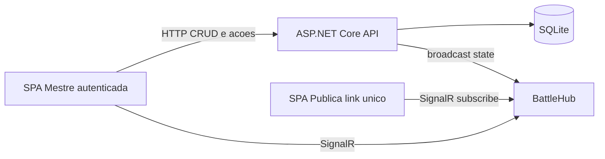

# IniciativasRPG — Backlog mestre

Fonte da verdade do que deve ser feito. Use este arquivo para consultar escopo, prioridades e critérios de aceitação ao planejar cada fase.

**Stack alvo:** ASP.NET Core Web API + SignalR · React + TypeScript · SQLite (EF Core)  
**Auth mestre:** usuário/senha com hash (sem OAuth nesta entrega)  
**Sessão:** 1 batalha ativa por vez

---

## Índice por prioridade MoSCoW

| Prioridade | Stories | Fase de entrega |
|---|---|---|
| **MUST** | ST-001, ST-002, ST-003, ST-004, ST-005, ST-006, ST-008, ST-009, ST-011, ST-016, ST-017, ST-018, ST-019 | Fase 1 |
| **SHOULD** | ST-007, ST-010, ST-012, ST-013, ST-014 | Fase 2 |
| **COULD** | ST-020 | Fase 3 |
| **WON'T** | Múltiplas batalhas simultâneas; OAuth para login do mestre | Fora do time-box |

---

## Checklist rápido por fase

### Fase 1 — MUST (MVP funcional)

- [x] ST-001 Cadastrar ficha
- [x] ST-002 Editar ficha fora de batalha
- [x] ST-003 Invocar player com iniciativa
- [x] ST-004 Invocar criatura (manual ou dado)
- [x] ST-005 Iniciar batalha
- [x] ST-006 Próximo turno (pula mortos / pular turno)
- [x] ST-008 Finalizar batalha
- [x] ST-009 Marcar como morto
- [x] ST-011 Aplicar dano
- [x] ST-016 Card do combatente
- [x] ST-017 Login do mestre
- [x] ST-018 Tela pública via link
- [x] ST-019 Sincronização em tempo real (SignalR)

### Fase 2 — SHOULD

- [x] ST-007 Decremento de duração dos modificadores ao fim da volta
- [x] ST-010 Reviver combatente
- [x] ST-012 Restaurar vida (cura)
- [x] ST-013 Cadastrar tipo de modificador
- [x] ST-014 Aplicar/remover modificador em combate

### Fase 3 — COULD (produto completo)

- [x] ST-015 Buff/debuff de CA (via modificadores avançados)
- [x] ST-020 Persistência de estatísticas pós-batalha (players)

---

## Objetivos de negócio (RTM)

| ID | Categoria | Descrição | Prioridade |
|---|---|---|---|
| BR-001 | Negócio | Reduzir tempo de cálculo manual de iniciativa/turno | Must |
| BR-002 | Negócio | Jogadores acompanham combate em tempo real | Must |
| BR-003 | Negócio | Reaproveitar estatísticas entre batalhas | Could |

### Regras de negócio

| ID | Descrição |
|---|---|
| BR-RULE-001 | Empate de iniciativa: desempate pelo **maior modificador de destreza** |
| BR-RULE-005 | Fichas **criatura** e **NPC** não têm estatísticas persistidas automaticamente ao final da batalha |
| BR-RULE-007 | Escopo: **1 batalha ativa por vez**; tela pública sem combate mostra mensagem adequada |

### NFRs

| ID | Descrição | Prioridade |
|---|---|---|
| NFR-PERF-001 | Atualização na tela pública em 2–3s (p95) após ação do mestre | Must |
| NFR-SEC-001 | Edição restrita ao mestre autenticado | Must |
| NFR-SEC-002 | Senha armazenada com hash | Must |

### Decisões de produto travadas

| Tema | Decisão |
|---|---|
| ST-012 (cura em morto) | **Bloquear** e orientar a usar Reviver antes (não auto-revive) |
| Imagem da ficha | Na implementação inicial: **URL** (upload em disco pode vir depois) |
| Link público | Token/slug único da sessão de batalha |
| Frontend | React + TypeScript; cliente SignalR `@microsoft/signalr` |
| Segredos / hardcode | Ver seção **Padrões de segurança e configuração** e regras em `.cursor/rules/` |

---

## Padrões de segurança e configuração

Regras persistentes do agente: [`.cursor/rules/`](../.cursor/rules/).

| Prática | Como aplicar |
|---|---|
| Sem hardcode de segredos | Senhas, `Jwt:Key`, connection strings só via config / User Secrets / env |
| `appsettings.json` versionado | Estrutura e defaults **não sensíveis**; placeholders apenas |
| Segredos locais | `dotnet user-secrets` ou `appsettings.Development.json` (gitignored) |
| Options pattern | Classes tipadas + `IOptions<T>`; evitar `Configuration["chave"]` espalhado |
| Frontend | `VITE_*` + `.env.example`; nunca JWT/senha no bundle |
| Tokens | JWT do mestre em Bearer; token público da batalha só para leitura |
| Login | Mensagem de erro genérica (não distinguir usuário vs senha) |

---

## Arquitetura alvo

```text
/docs/BACKLOG.md
/src/IniciativasRPG.Api/     # ASP.NET Core + SignalR + EF Core/SQLite
/src/IniciativasRPG.Web/     # React + TypeScript
```



### Domínio (entidades)

| Entidade | Responsabilidade |
|---|---|
| `User` | Credenciais do mestre |
| `Sheet` | Ficha reutilizável (player, criatura ou NPC): nome, imagem, HP atual/máx, CA base, DEX mod |
| `Battle` | Sessão de combate (status, token público, índice do turno) |
| `Combatant` | Instância na fila: iniciativa, HP/CA de combate, morto?, referência à Sheet |
| `ModifierType` | Catálogo (nome, duração padrão, flag pula turno) |
| `ActiveModifier` | Instância no combatente (duração restante, pula turno) |
| `ActiveModifier` | Efeitos em combate: pula turno, ΔCA, dano (fixo/dado), ícone |

---

## Épicos e stories

### EPIC-01 — Gestão de Fichas

#### ST-001 — Cadastrar ficha
- **Prioridade:** MUST · **Fase:** 1 · **FR:** FR-001 · **Status:** Done
- **Como** mestre, **quero** cadastrar uma ficha (player ou criatura) com nome, imagem, vida atual/máxima, CA base e modificador de destreza, **para** reutilizá-la ao montar combates.
- **Critérios de aceitação:**
  - Dado que estou na tela de fichas, quando preencho nome, vida máxima, CA e modificador de destreza e salvo, então a ficha é criada com vida atual igual à máxima e listada no repositório.
  - Dado que não informei nome, quando tento salvar, então o sistema bloqueia e exibe erro de campo obrigatório.
  - Dado que marco o tipo como "player", então a ficha fica elegível para persistência pós-batalha (FR-020 / ST-020).
- **INVEST:** Independent ✔ / Negotiable ✔ / Valuable ✔ / Estimable ✔ / Small ✔ / Testable ✔

#### ST-002 — Editar ficha fora de batalha
- **Prioridade:** MUST · **Fase:** 1 · **Status:** Done
- **Como** mestre, **quero** editar uma ficha existente fora de uma batalha ativa, **para** corrigir ou atualizar dados sem recriá-la.
- **Critérios de aceitação:**
  - Dado que uma ficha existe e não está em combate, quando altero vida máxima ou CA e salvo, então os novos valores são refletidos na listagem.
  - Dado que a ficha está participando de uma batalha ativa, quando tento editá-la, então o sistema impede a edição direta e orienta usar as ações de combate (dano/cura/modificador).

---

### EPIC-02 — Controle de Iniciativa e Turnos

#### ST-003 — Invocar player com iniciativa
- **Prioridade:** MUST · **Fase:** 1 · **FR:** FR-003 · **Status:** Done
- **Como** mestre, **quero** invocar um player já com o valor da iniciativa informado, **para** que ele seja posicionado automaticamente na fila.
- **Critérios de aceitação:**
  - Dado que seleciono uma ficha de player e informo a iniciativa, quando confirmo, então ele é inserido na fila em ordem decrescente.
  - Dado que dois combatentes têm o mesmo valor de iniciativa, então o desempate segue o maior modificador de destreza (BR-RULE-001).
  - Dado que o mesmo player já está na fila da batalha atual, quando tento invocá-lo novamente, então o sistema alerta duplicidade antes de confirmar.

#### ST-004 — Invocar criatura (manual ou dado)
- **Prioridade:** MUST · **Fase:** 1 · **FR:** FR-004 · **Status:** Done
- **Como** mestre, **quero** invocar uma criatura informando manualmente a iniciativa ou pedindo para o sistema rolar o dado (notação configurável, ex.: `1d20+3`), **para** posicioná-la corretamente na fila.
- **Critérios de aceitação:**
  - Dado que informo a iniciativa manualmente, quando confirmo, então a criatura é posicionada conforme esse valor.
  - Dado que escolho "rolar dado" e defino `1d20+2`, quando confirmo, então o sistema executa a rolagem, exibe o resultado e posiciona a criatura.
  - Empates seguem BR-RULE-001.

#### ST-005 — Iniciar batalha
- **Prioridade:** MUST · **Fase:** 1 · **FR:** FR-005 · **Status:** Done
- **Como** mestre, **quero** iniciar a batalha, **para** que o combatente de maior iniciativa fique em destaque.
- **Critérios de aceitação:**
  - Dado que há ao menos 2 combatentes, quando clico em "Iniciar Batalha", então o de maior iniciativa é destacado e os botões "Próximo" e "Finalizar Batalha" ficam disponíveis.
  - Dado que a fila está vazia ou com 1 combatente, quando tento iniciar, então o sistema bloqueia com mensagem explicativa.
  - Dado que a batalha já está iniciada, o botão "Iniciar Batalha" fica indisponível.

#### ST-006 — Próximo turno
- **Prioridade:** MUST · **Fase:** 1 · **FR:** FR-006 · **Status:** Done
- **Como** mestre, **quero** acionar "Próximo" para destacar o próximo combatente, **pulando** automaticamente quem está morto ou com efeito ativo que force pular turno.
- **Critérios de aceitação:**
  - Com batalha ativa, "Próximo" move o destaque para o próximo vivo e sem "pular turno" ativo.
  - Mortos são ignorados na rotação.
  - Modificador com flag "pula turno" ativo: combatente é pulado e o modificador é considerado consumido para aquela rodada.
  - Ao passar do último, retorna ao topo (volta completa → dispara FR-007 / ST-007 na Fase 2).

#### ST-007 — Decremento de duração ao fim da volta
- **Prioridade:** SHOULD · **Fase:** 2 · **FR:** FR-007 · **Status:** Done
- **Dependências:** FR-006, FR-014
- **Como** mestre, **quero** que a duração de todos os modificadores/efeitos ativos seja decrementada em 1 ao final de cada volta completa da fila.
- **Critérios de aceitação:**
  - Quando o destaque retorna ao topo, todo modificador ativo tem duração −1.
  - Duração 0 → remoção automática do combatente.
  - Buff/debuff de CA em 0 → CA exibida volta ao valor base (completo com ST-015).

#### ST-008 — Finalizar batalha
- **Prioridade:** MUST · **Fase:** 1 · **Status:** Done
- **Como** mestre, **quero** finalizar a batalha, **para** encerrar o combate e habilitar o salvamento de estatísticas.
- **Critérios de aceitação:**
  - Com batalha ativa, "Finalizar Batalha" encerra a fila e oferece opção de salvar estatísticas das fichas player (FR-020 / ST-020 — UI pode existir na Fase 1; persistência efetiva na Fase 3).
  - Tela pública reflete que não há combate ativo.

#### ST-009 — Marcar como morto
- **Prioridade:** MUST · **Fase:** 1 · **FR:** FR-009 · **Status:** Done
- **Dependências:** FR-011
- **Como** mestre, **quero** marcar um combatente com vida 0 como morto, **para** que fique visualmente opaco com um X e seja excluído da rotação.
- **Critérios de aceitação:**
  - Vida = 0 → botão "Matar" aparece; ao confirmar, ícone opaco com X.
  - Mortos são pulados no "Próximo" (ST-006).
  - Vida > 0 → botão "Matar" não é exibido.

#### ST-010 — Reviver combatente
- **Prioridade:** SHOULD · **Fase:** 2 · **FR:** FR-010 · **Status:** Done
- **Dependências:** FR-009
- **Como** mestre, **quero** reviver um combatente marcado como morto, **para** retorná-lo à rotação normal.
- **Critérios de aceitação:**
  - "Reviver" remove visual opaco/X e o torna elegível na fila.
  - Se vida atual = 0 ao reviver, o sistema exige/permite definir vida atual (ex.: via restaurar) para evitar estado inconsistente.

---

### EPIC-03 — Combate (Dano, Cura, Efeitos)

#### ST-011 — Aplicar dano
- **Prioridade:** MUST · **Fase:** 1 · **FR:** FR-011 · **Status:** Done
- **Como** mestre, **quero** aplicar dano a um player ou criatura, **para** reduzir sua vida atual.
- **Critérios de aceitação:**
  - Vida atual reduz pelo valor informado, mínimo 0 (nunca negativa).
  - Se vida chega a 0, o botão "Matar" passa a ser exibido (ST-009).

#### ST-012 — Restaurar vida
- **Prioridade:** SHOULD · **Fase:** 2 · **FR:** FR-012 · **Status:** Done
- **Como** mestre, **quero** restaurar vida, **para** refletir cura em combate.
- **Critérios de aceitação:**
  - Cura aumenta vida atual sem ultrapassar a máxima.
  - Combatente morto: **bloquear** e orientar a reviver antes (decisão travada).

#### ST-013 — Cadastrar tipo de modificador
- **Prioridade:** SHOULD · **Fase:** 2 · **FR:** FR-013 · **Status:** Done
- **Como** mestre, **quero** cadastrar tipos de modificador (ex.: envenenado, atordoado) com duração padrão e flag "pula turno".
- **Critérios de aceitação:**
  - Salvar nome + duração padrão + flag "pula turno" disponibiliza o tipo para aplicação futura.
  - Sem "pula turno": não interfere em ST-006; apenas etiqueta visual.

#### ST-014 — Aplicar modificador em combate
- **Prioridade:** SHOULD · **Fase:** 2 · **FR:** FR-014 · **Status:** Done
- **Dependências:** FR-013
- **Como** mestre, **quero** aplicar um modificador cadastrado a um combatente, podendo ajustar a duração da instância.
- **Critérios de aceitação:**
  - Confirmar com duração padrão → aparece ativo no card.
  - Duração customizada é a usada no decremento (ST-007).
  - Remoção manual remove imediatamente exibição e efeito.

#### ST-015 — Buff/debuff de CA
- **Prioridade:** COULD · **Fase:** 3 · **FR:** FR-015 · **Status:** Done
- **Dependências:** FR-013 / FR-014
- **Como** mestre, **quero** aplicar buff/debuff de CA (valor +/− com duração em turnos).
- **Implementação:** campo `AcDelta` no tipo/instância de modificador (sem entidade `ArmorModifier` separada). Combina com pula turno e dano periódico (`Fixed` | `DicePerTurn` | `DiceOnce`). Tick de dano no início do turno do afetado; ícone preset ou URL; badge com duração e último dano.
- **Critérios de aceitação:**
  - Buff +2 CA por 3 turnos → CA exibida = base + 2.
  - Debuff −3 CA → CA reduzida conforme o valor.
  - Duração 0 (via ST-007) → CA volta ao valor base.
  - Ícone + duração (e dano, se houver) visíveis na fila e na tela pública via SignalR.

#### ST-016 — Card do combatente
- **Prioridade:** MUST · **Fase:** 1 · **FR:** FR-016 · **Status:** Done
- **Como** mestre e jogador, **quero** ver no card imagem, vida atual/máxima, iniciativa, CA (com efeitos) e indicadores de modificadores.
- **Critérios de aceitação:**
  - Card mostra imagem, HP atual/máx, iniciativa e CA atualizada.
  - Modificadores ativos aparecem como indicadores distintos.
  - Morto: opaco com X, sem indicadores de turno ativo.

---

### EPIC-04 — Acesso em Tempo Real

#### ST-017 — Login do mestre
- **Prioridade:** MUST · **Fase:** 1 · **FR:** FR-017 · **Status:** Done
- **Como** mestre, **quero** autenticar-me com usuário e senha, **para** acessar as funcionalidades de edição.
- **Critérios de aceitação:**
  - Credenciais corretas → tela de controle do mestre com ações habilitadas.
  - Credenciais inválidas → nega acesso com mensagem **genérica** (não distinguir usuário vs senha).
  - URL de controle sem auth → redireciona para login.

#### ST-018 — Tela pública via link
- **Prioridade:** MUST · **Fase:** 1 · **FR:** FR-018 · **Status:** Done
- **Como** jogador, **quero** acessar a batalha via link único da sessão, sem login, **para** acompanhar em modo somente leitura.
- **Critérios de aceitação:**
  - Link da sessão → estado atual (fila, cards, destaque) sem edição.
  - Nenhum controle de edição exibido/habilitado.
  - Sem batalha ativa → mensagem (BR-RULE-007).

#### ST-019 — Sincronização em tempo real
- **Prioridade:** MUST · **Fase:** 1 · **FR:** FR-019 · **NFR:** NFR-PERF-001 · **Status:** Done
- **Como** jogador, **quero** que ações do mestre reflitam automaticamente na minha tela em até 2–3 segundos.
- **Critérios de aceitação:**
  - Dano confirmado → vida atualizada na pública em ≤ 2–3s, sem refresh manual.
  - "Próximo" → destaque muda no mesmo intervalo.
  - Múltiplos clientes públicos recebem atualização consistente (SignalR broadcast).

---

### EPIC-05 — Persistência entre Batalhas

#### ST-020 — Salvar estatísticas pós-batalha
- **Prioridade:** COULD · **Fase:** 3 · **FR:** FR-020 · **Status:** Done
- **Dependências:** FR-008 (finalizar batalha)
- **Como** mestre, **quero** salvar estatísticas (vida, CA, etc.) das fichas **player** ao final da batalha.
- **Critérios de aceitação:**
  - Confirmar "salvar estatísticas" → vida atual e CA base (sem buffs/debuffs temporários) das fichas player são persistidas na ficha original.
  - Criaturas: não persistem automaticamente (BR-RULE-005).
  - Nova batalha: ao invocar o player, vida e CA vêm dos valores salvos.

---

## Mapa FR → Story

| FR | Descrição | Story | Prioridade |
|---|---|---|---|
| FR-001 | Cadastrar ficha | ST-001 | Must |
| FR-003 | Invocar player | ST-003 | Must |
| FR-004 | Invocar criatura | ST-004 | Must |
| FR-005 | Iniciar batalha | ST-005 | Must |
| FR-006 | Próximo turno | ST-006 | Must |
| FR-007 | Decremento duração | ST-007 | Should |
| FR-009 | Matar | ST-009 | Must |
| FR-010 | Reviver | ST-010 | Should |
| FR-011 | Aplicar dano | ST-011 | Must |
| FR-012 | Restaurar vida | ST-012 | Should |
| FR-013 | Cadastrar tipo modificador | ST-013 | Should |
| FR-014 | Aplicar modificador | ST-014 | Should |
| FR-015 | Buff/debuff CA | ST-015 | Could |
| FR-016 | Card do combatente | ST-016 | Must |
| FR-017 | Login mestre | ST-017 | Must |
| FR-018 | Tela pública | ST-018 | Must |
| FR-019 | Tempo real | ST-019 | Must |
| FR-020 | Persistência pós-batalha | ST-020 | Could |

---

## WON'T HAVE (neste time-box)

- Suporte a múltiplas batalhas simultâneas (mantém BR-RULE-007)
- OAuth para login do mestre

---

## Como usar este arquivo nos próximos planos

1. **Fase 1 (MUST)** — plano de implementação cobre apenas o checklist MUST; marcar checkboxes ao concluir.
2. **Fase 2 (SHOULD)** — novo plano consultando as stories SHOULD e dependências.
3. **Fase 3 (COULD)** — ST-015 e ST-020 concluídos; backlog MoSCoW completo para o time-box.

Atualize o campo **Status** de cada ST (`Todo` → `Doing` → `Done`) conforme o progresso.
